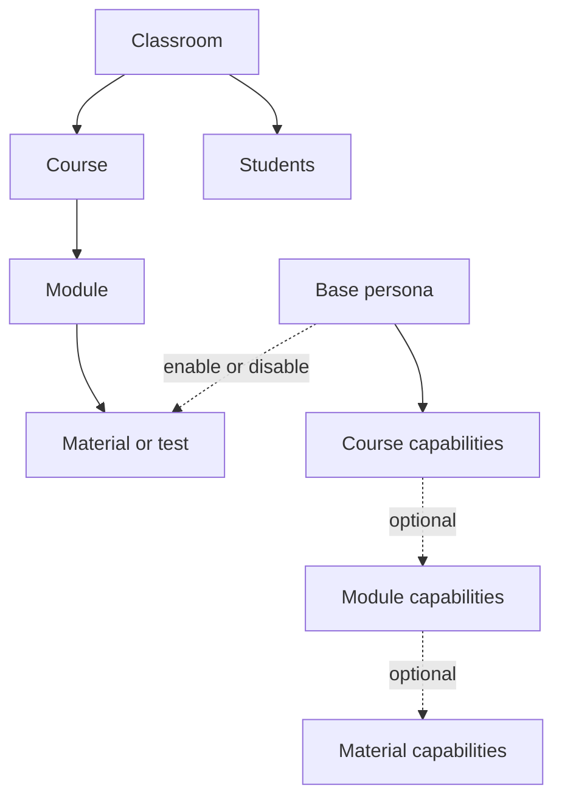
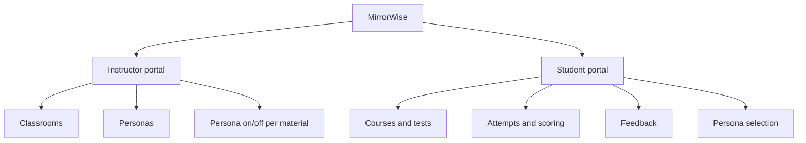
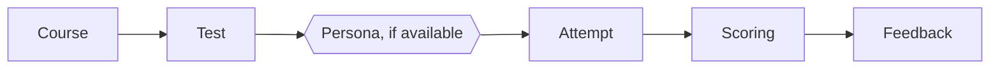

# MirrorWise

**One-on-one expert attention, at scale.**

MirrorWise scales personal tutoring through AI personas. Instructors provide the expertise, personas make it scalable, and students get patient, human-like attention whenever they need it.

The MVP targets **IELTS** preparation, with a live AI speaking examiner as the flagship. The platform is built to extend to other exams, interviews and subjects.

> **Status:** Pre-development. Requirements below are the current working plan and may change.

## Core idea

One-on-one tutoring is the most effective way to learn, but it doesn't scale: it's expensive, limited by a teacher's hours and tied to location. MirrorWise captures an expert's judgment and teaching style in a **persona** that can give individual attention to any number of students.

There are two kinds of persona:

- **Platform personas:** built by the MirrorWise team; available to everyone.
- **Instructor personas:** built from a real teacher's materials, examples and approach; owned by the teacher.

## Domain model

- **Course → Module → Material.** A course (e.g. IELTS) contains modules; modules hold learning materials and tests.
- **Base persona.** Holds identity (name, voice, personality) and general expertise.
- **Capabilities follow the content hierarchy:** course → module → material. Course-level capabilities are the default; deeper levels are optional overrides.
- **Per-material control.** A persona can be enabled or disabled on each material.
- **Classrooms** link an instructor's students to a course.

## Functional requirements

### Instructor

- Create a classroom, add students and link a course.
- Classroom students get the same view as subscribers, plus the materials their instructor specifies.
- Create, edit and delete personas (base persona plus capabilities by course → module → material).
- Enable or disable a persona on each material.
- Course create/edit/delete is out of scope for the MVP; courses are provided by the platform.

### Student

Built in phases:

| Step | Scope |
| --- | --- |
| 1. Student portal | Full course → test → attempt → scoring lifecycle; test attempts and feedback |
| 2. Personas and AI tutor layer | Persona selection for speaking / conversational tests |
| 3. AI tutor | Design decision: a platform-wide AI tutor, or tutoring built into learning materials with personas |
| 4. Personalized learning | Learning material tailored to each student's weaknesses |
| 5. Subscriptions | Subscription payment features |

## Architecture

Student flow:

## Documentation

- Product requirements (MVP): *link to PRD*
